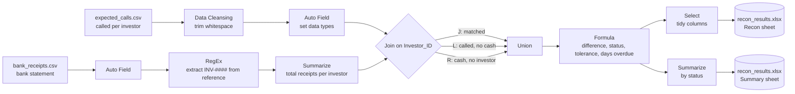

# Capital Call Cash Reconciliation in Alteryx


<p align="center">
  
  
  
</p>

An Alteryx Designer workflow that reconciles a private fund's **capital call** against the **bank receipts**. It classifies every investor as matched, short-paid, outstanding or unidentified, and ties the totals back to source so nothing is lost or double-counted.

Built as a hands-on learning project in private fund administration. All data is fictional.


## The business problem

When a private equity or private credit fund needs money, the general partner issues a **capital call**: each investor (limited partner) must pay its share of the call, pro rata to its commitment, by a due date. The fund administrator then has to answer three questions:

1. Who paid in full?
2. Who paid the wrong amount, or nothing at all?
3. Is there cash in the bank that can't be matched to any investor?

In practice the data is messy. Bank references are free text, some investors pay in instalments, small bank charges create penny differences, and a stray space in an ID can make a correct payment look unpaid. This workflow handles all of these.

## Scenario

| Item | Value |
| --- | --- |
| Fund | Liffey Credit Fund I (fictional) |
| Call notice | CC-003, 10% of commitments |
| Investors | 12 |
| Total called | €25,000,000 |
| Due date | 29 September 2026 |

## How it works



| Step | Tool | Why |
| --- | --- | --- |
| 1 | Data Cleansing | Removes leading and trailing whitespace. One investor ID has a trailing space that would otherwise create a false break |
| 2 | Auto Field | CSVs load as text; this converts amounts to numbers and dates to dates |
| 3 | RegEx (Parse) | Pulls the investor ID out of free-text bank references such as `CC003/INV-0004/LIFFEY CREDIT I` using `(INV-\d{4})` |
| 4 | Summarize | Totals receipts per investor, so a payment split into two instalments is matched once, not flagged twice |
| 5 | Join | The core of the reconciliation. **J** = called and paid, **L** = called but no cash, **R** = cash with no matching investor |
| 6 | Union + Formula | Recombines all three outputs and assigns each row a status, applying a €25 tolerance for bank charges and counting days overdue from the run date |
| 7 | Select + Output | Writes a clean detail sheet and a summary sheet by status for the reviewer |

The Join on `Investor_ID` is where the reconciliation happens. Its three outputs separate paid investors (J), called investors with no cash (L) and cash with no matching investor (R):


## Seeded exceptions

Five problems were planted in the test data, plus one split payment to test aggregation. The workflow handles all six correctly.

| # | Problem planted | Investor | How it's handled | Result |
| --- | --- | --- | --- | --- |
| 1 | Trailing space in investor ID | INV-0003 | Data Cleansing | Matched (no false break) |
| 2 | Payment split into two instalments | INV-0002 | Summarize by investor | Matched |
| 3 | €15 short (bank charges) | INV-0011 | €25 tolerance in Formula | Matched within tolerance |
| 4 | €500,000 short-paid | INV-0006 | Formula | Break: amount differs |
| 5 | No payment received | INV-0009 | Join L output | Outstanding, with days overdue |
| 6 | €750,000 with no investor ID in the reference | Harbour Point Family Office | Join R output | Unidentified receipt: investigate before booking |

## Results

| Status | Investors | Called (€) | Received (€) | Difference (€) |
| --- | --- | --- | --- | --- |
| Matched | 9 | 19,600,000 | 19,600,000 | 0 |
| Matched within tolerance (bank charges) | 1 | 2,200,000 | 2,199,985 | −15 |
| Break: amount differs | 1 | 2,000,000 | 1,500,000 | −500,000 |
| Outstanding: no cash received | 1 | 1,200,000 | 0 | −1,200,000 |
| Unidentified receipt | 1 | 0 | 750,000 | 750,000 |
| **Total** | **12 + 1 receipt** | **25,000,000** | **24,049,985** | **−950,015** |

**Control check:** total called (€25,000,000) ties to the call notice, and total received (€24,049,985) ties to the bank statement. Every euro on both sides is accounted for.


## How to run it

1. Install [Alteryx Designer](https://www.alteryx.com/) (Windows).
2. Clone or download this repository.
3. Open `CapitalCall_Recon.yxmd` from the repository folder. File paths are relative, so the workflow reads from `data/` and writes to `output/`.
4. Press **Run** (Ctrl + R). Close `output/recon_results.xlsx` in Excel first, or Alteryx can't overwrite it.

`Days_Overdue` is calculated from today's date, so it will grow each day you run it.

## Repository structure

```
├── CapitalCall_Recon.yxmd    Alteryx workflow
├── data/
│   ├── expected_calls.csv    capital call per investor (accounting system extract)
│   └── bank_receipts.csv     bank statement export
├── output/
│   └── recon_results.xlsx    Recon (detail) and Summary sheets
├── images/                   cover image and screenshots
└── LICENSE
```

## Next steps

- **Automated tie-out:** a Test tool that stops the workflow if total received doesn't equal the bank total, or total called doesn't equal the call notice.
- **Align the Union inputs:** the Join's three outputs have different columns, which raises informational warnings. A Select on each branch would remove them.
- **Parameterise:** make the tolerance, the as-of date and the call notice user inputs instead of fixed values.
- **Investor-level detail:** show the side-letter terms and each investor's unfunded commitment after the call.

## Tech
Alteryx Designer (`.yxmd`), RegEx parsing, Excel output

## Disclaimer

All fund names, investor names and amounts are fictional and were created for this project. Any resemblance to real entities is coincidental.
