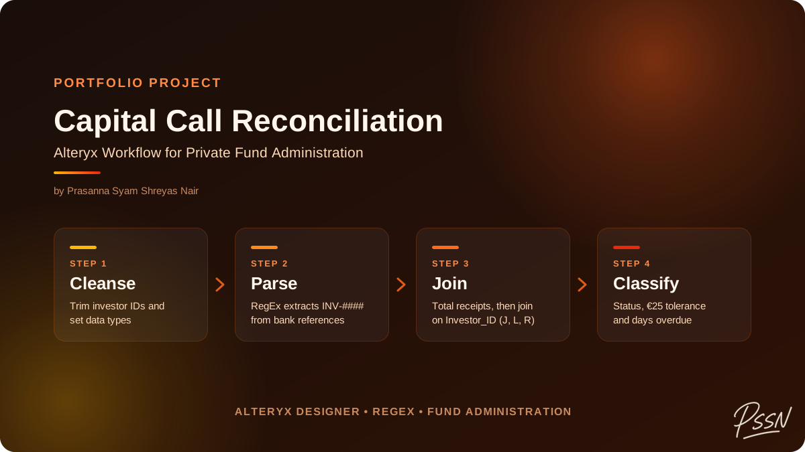
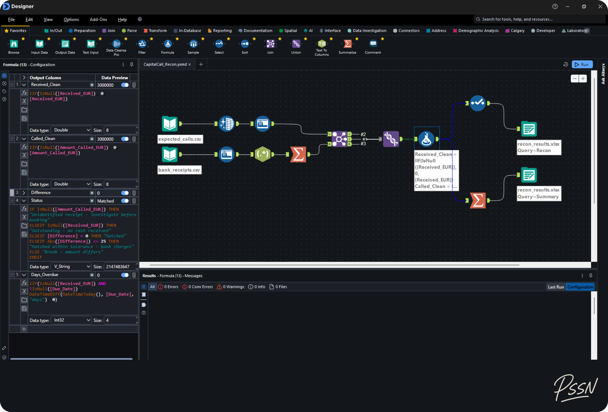
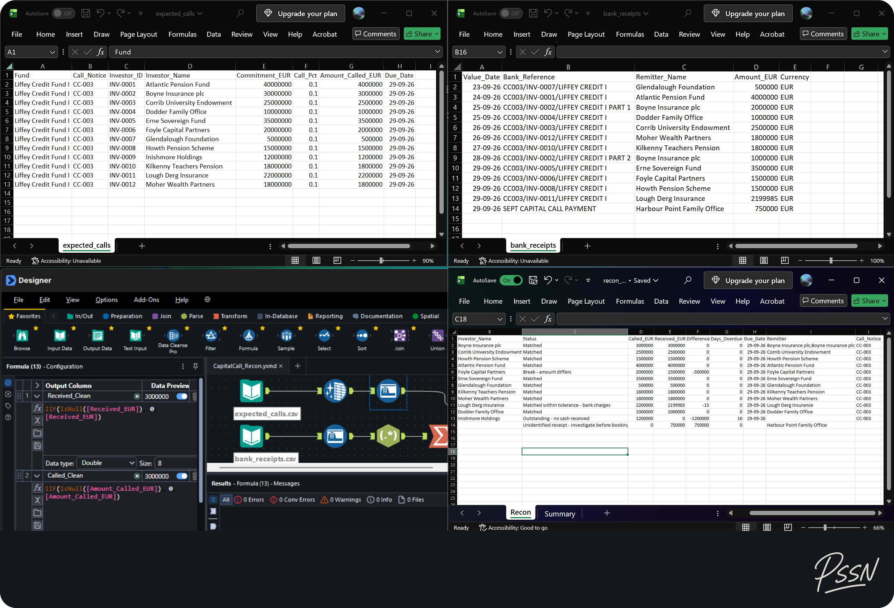
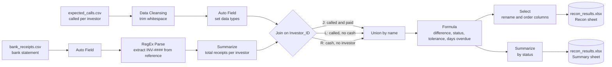
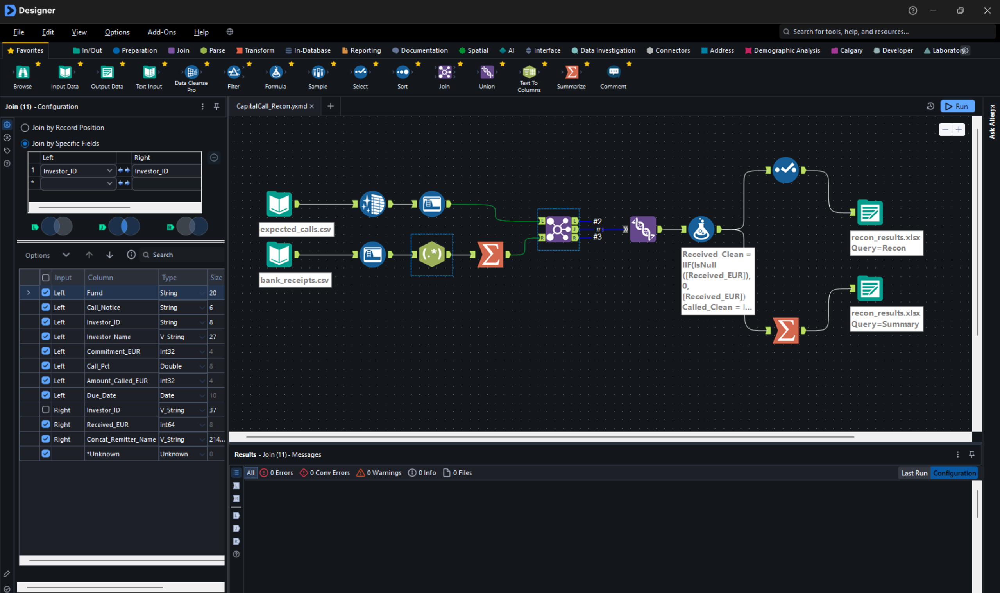

# Capital Call Cash Reconciliation in Alteryx



<p align="center">
  
  
  
</p>

## At a glance

A fund has asked its 12 investors for **€25 million**. The bank statement shows what actually arrived. This Alteryx workflow compares the two and tells the fund administrator, investor by investor, **who has paid, who has not, and what cash cannot be explained**, then proves the totals tie back to source so nothing is lost or counted twice.

| What it answers | Result on the sample data |
| --- | --- |
| Who paid in full? | 10 investors (one within a €25 bank-charge tolerance) |
| Who paid the wrong amount? | 1 investor, €500,000 short |
| Who paid nothing? | 1 investor, €1,200,000 outstanding and counted as days overdue |
| Is there cash we can't identify? | 1 receipt of €750,000 with no investor reference, flagged before booking |
| Do the totals tie out? | Yes: €25,000,000 called ties to the call notice, €24,049,985 received ties to the bank statement |

The workflow runs in one click and writes a reviewer-ready Excel file with a detail sheet and a summary sheet. Built as a hands-on learning project in private fund administration. All data is fictional.



---

## Contents

- [The business problem](#the-business-problem)
- [The scenario](#the-scenario)
- [What makes the data hard](#what-makes-the-data-hard)
- [Results and control check](#results-and-control-check)
- [Inside the workflow](#inside-the-workflow)
- [Key configurations](#key-configurations)
- [Design decisions](#design-decisions)
- [How to run it](#how-to-run-it)
- [Repository structure](#repository-structure)
- [Next steps](#next-steps)

---

## The business problem

When a private equity or private credit fund needs money for an investment, the general partner issues a **capital call**: each investor (limited partner) pays its share, pro rata to its commitment, by a due date. Before the cash can be booked, the fund administrator has to reconcile what was **called** against what was **received**.

Done by hand in Excel, this means scanning free-text bank references, adding up split payments and chasing small differences, with the risk that one missed payment or one unidentified receipt slips through. This workflow makes that check repeatable, auditable and fast.

## The scenario

| Item | Value |
| --- | --- |
| Fund | Liffey Credit Fund I (fictional) |
| Call notice | CC-003, 10% of commitments |
| Investors | 12 |
| Total called | €25,000,000 |
| Due date | 29 September 2026 |
| Inputs | `expected_calls.csv` (accounting system extract) and `bank_receipts.csv` (bank statement export) |

## What makes the data hard

Real reconciliation data is messy, so six problems were planted in the sample files. The workflow handles all six.

| # | Problem in the data | Investor | Why it matters | How the workflow handles it | Outcome |
| --- | --- | --- | --- | --- | --- |
| 1 | Trailing space in an investor ID (`INV-0003 `) | Corrib University Endowment | A correct payment would look unpaid | Data Cleansing trims whitespace before the join | Matched, no false break |
| 2 | Payment split into two instalments | Boyne Insurance plc | Each instalment alone looks short | Summarize totals receipts per investor before matching | Matched |
| 3 | €15 short due to bank charges | Lough Derg Insurance | A trivial difference should not need chasing | €25 tolerance in the status formula | Matched within tolerance |
| 4 | €500,000 short-paid | Foyle Capital Partners | A real break the investor must be chased for | Difference calculated and flagged | Break: amount differs |
| 5 | No payment received | Inishmore Holdings | Investor in default risk after the due date | Join **L** output (called, no cash) | Outstanding, with days overdue |
| 6 | €750,000 with no investor ID in the reference | Harbour Point Family Office | Cash cannot be booked until identified | Join **R** output (cash, no investor) | Unidentified receipt: investigate before booking |

## Results and control check

| Status | Investors | Called (€) | Received (€) | Difference (€) |
| --- | --- | --- | --- | --- |
| Matched | 9 | 19,600,000 | 19,600,000 | 0 |
| Matched within tolerance (bank charges) | 1 | 2,200,000 | 2,199,985 | −15 |
| Break: amount differs | 1 | 2,000,000 | 1,500,000 | −500,000 |
| Outstanding: no cash received | 1 | 1,200,000 | 0 | −1,200,000 |
| Unidentified receipt | 1 | 0 | 750,000 | 750,000 |
| **Total** | **12 + 1 receipt** | **25,000,000** | **24,049,985** | **−950,015** |

**Control check:** total called (€25,000,000) ties to the call notice, and total received (€24,049,985) ties to the bank statement. Every euro on both sides appears exactly once in the output, so nothing was dropped by the join or double-counted by the aggregation.



---

## Inside the workflow



| Step | Alteryx tool | What it does |
| --- | --- | --- |
| 1 | Input Data (x2) | Reads both CSVs using relative paths, so the workflow runs from any folder |
| 2 | Data Cleansing | Removes leading and trailing whitespace from the call file |
| 3 | Auto Field (x2) | CSVs load as text; this sets amounts to numeric types and dates to Date |
| 4 | RegEx (Parse) | Extracts the investor ID from free-text bank references such as `CC003/INV-0004/LIFFEY CREDIT I` |
| 5 | Summarize | Groups receipts by investor: sums the amount and concatenates remitter names |
| 6 | Join | Matches called amounts to receipts on `Investor_ID`, using all three outputs (J, L and R) |
| 7 | Union | Stacks the three Join outputs back together by field name |
| 8 | Formula | Replaces nulls, calculates the difference, assigns a status and counts days overdue |
| 9 | Select | Renames and orders the columns the reviewer needs, drops the working fields |
| 10 | Summarize | Builds the summary by status (count, called, received, difference) |
| 11 | Output Data (x2) | Writes the `Recon` and `Summary` sheets to one Excel file, overwriting on each run |

The Join is the heart of the reconciliation. Its three outputs map directly onto the three questions a fund administrator asks:



## Key configurations

**RegEx (Parse method), case-insensitive**, on `Bank_Reference`, output to a new `Investor_ID` field:

```
(INV-\d{4})
```

References that contain no investor ID (such as `SEPT CAPITAL CALL PAYMENT`) return a null `Investor_ID`, which later sends that receipt to the Join's **R** output instead of being silently matched or dropped.

**Summarize** before the Join:

| Field | Action | Output name |
| --- | --- | --- |
| `Investor_ID` | Group By | `Investor_ID` |
| `Amount_EUR` | Sum | `Received_EUR` |
| `Remitter_Name` | Concatenate | `Remitter` (after Select) |

**Join** on `Investor_ID` (left: called, right: received), with the duplicate right-hand ID deselected. All three anchors feed the Union, configured **by name** so the different column sets line up.

**Formula** (applied in order, each field available to the next):

```
Received_Clean = IIF(IsNull([Received_EUR]), 0, [Received_EUR])
Called_Clean   = IIF(IsNull([Amount_Called_EUR]), 0, [Amount_Called_EUR])
Difference     = [Received_Clean] - [Called_Clean]

Status =
  IF IsNull([Amount_Called_EUR]) THEN "Unidentified receipt - investigate before booking"
  ELSEIF IsNull([Received_EUR]) THEN "Outstanding - no cash received"
  ELSEIF [Difference] = 0 THEN "Matched"
  ELSEIF Abs([Difference]) <= 25 THEN "Matched within tolerance - bank charges"
  ELSE "Break - amount differs"
  ENDIF

Days_Overdue = IIF(IsNull([Received_EUR]) AND !IsNull([Due_Date]),
                   DateTimeDiff(DateTimeToday(), [Due_Date], "days"), 0)
```

**Output Data:** one Excel file, two sheets (`output\recon_results.xlsx|||Recon` and `|||Summary`), set to overwrite.

## Design decisions

- **Aggregate before joining.** Summing receipts per investor first means a split payment is matched once against the full call. Joining first would produce two partial rows and two false breaks.
- **Keep all three Join outputs.** Using only the J output would quietly drop the unpaid investor (L) and the unidentified cash (R), which are exactly the items a reviewer most needs to see.
- **Null handling before arithmetic.** Rows from the L and R outputs have nulls on one side. Converting them to 0 first keeps the difference and the summary totals correct.
- **Status order matters.** The IF chain checks the missing-data cases first, then exact match, then tolerance, so every row lands in exactly one status.
- **Tolerance uses `Abs()`.** Bank charges usually make a receipt slightly short, but a small overpayment within €25 is also treated as matched rather than raised as a break.
- **Relative paths.** Inputs and outputs are referenced relative to the workflow, so it runs on any machine without editing paths.

## How to run it

1. Install [Alteryx Designer](https://www.alteryx.com/) (Windows).
2. Clone or download this repository.
3. Open `CapitalCall_Recon.yxmd` from the repository folder.
4. Press **Run** (Ctrl + R). Close `output/recon_results.xlsx` in Excel first, or Alteryx can't overwrite it.

`Days_Overdue` is calculated from today's date, so it grows each day you run it.

## Repository structure

```
├── CapitalCall_Recon.yxmd    Alteryx workflow
├── data/
│   ├── expected_calls.csv    capital call per investor (accounting system extract)
│   └── bank_receipts.csv     bank statement export
├── output/
│   └── recon_results.xlsx    Recon (detail) and Summary sheets
├── images/                   cover image and screenshots
└── LICENSE
```

## Next steps

- **Automated tie-out:** a Test tool that stops the workflow if total received doesn't equal the bank total, or total called doesn't equal the call notice.
- **Align the Union inputs:** the Join's three outputs have different columns, which raises informational warnings. A Select on each branch would remove them.
- **Parameterise:** turn the workflow into an analytic app so the tolerance, as-of date and call notice are user inputs instead of fixed values.
- **Investor-level detail:** add each investor's unfunded commitment after the call, and any side-letter terms.

## Tech

Alteryx Designer (`.yxmd`): Input Data, Data Cleansing, Auto Field, RegEx, Summarize, Join, Union, Formula, Select, Output Data. Excel output.

## Disclaimer

All fund names, investor names and amounts are fictional and were created for this project. Any resemblance to real entities is coincidental.

## Author

**Prasanna Syam Shreyas Nair** · Ex-JPMorganChase · First Class Honours MSc in Business Analytics, Dublin Business School · [GitHub](https://github.com/Nair-Shreyas) · [LinkedIn](https://www.linkedin.com/in/psshreyasnair/)
